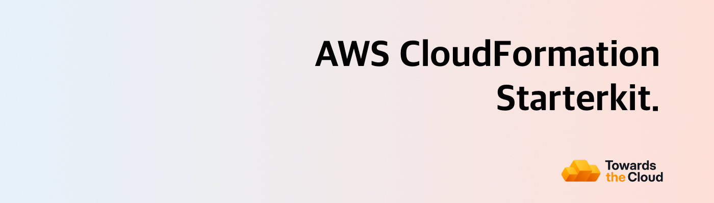

# [](https://towardsthecloud.com)

## AWS CloudFormation Starter Kit

Welcome to the AWS CloudFormation Starter Kit, designed to streamline your infrastructure setup using CloudFormation templates and the AWS CLI. This repository provides a structured approach to managing your AWS resources as code, ensuring efficient and reliable deployments.

### 🚀 Features

- ⚡ **One Command per Task**: `make init`, `make diff`, and `make deploy` work the same on your machine and in CI
  - Generates environment-specific parameter files and deploy workflows
  - Provisions OIDC provider for secure keyless authentication
  - Previews changes as a CloudFormation change set before you deploy
- 🔒 **Secure Deployments**: Deploy stacks via OIDC-authenticated GitHub Actions—no long-lived IAM credentials needed
- 🤖 **Pre-Commit Validation**: cfn-lint and Checkov catch issues before deployment
- 🌐 **Multi-Environment Support**: Separate parameter files and a deploy workflow per environment
- 🧩 **Easy to Extend**: `make new-stack` scaffolds a stack, and one Makefile line sets the deploy order

<!-- TIP-LIST:START -->
> [!TIP]
> **Catch AWS waste before and after you deploy.**
>
> [CloudBurn](https://cloudburn.io) is a free, open-source CLI that checks your Terraform and CloudFormation for costly patterns before deploy, then finds the waste already running in your AWS account. Run it locally or in CI.
>
> <a href="https://github.com/towardsthecloud/cloudburn"></a>
>
> Want it managed across your AWS accounts? [CloudBurn Platform](https://cloudburn.io) runs it for you and keeps scan results in your own account. Join the waitlist for 30% off.
<!-- TIP-LIST:END -->

### Quick Start

You need **Python 3**, the [AWS CLI](https://docs.aws.amazon.com/cli/latest/userguide/getting-started-install.html), and [yq](https://github.com/mikefarah/yq#install). macOS ships the `make` this kit uses.

1. Click the green ["Use this template"](https://github.com/new?template_name=aws-cloudformation-starter-kit&template_owner=towardsthecloud) button to create a new repository based on this starter kit.

2. Install the AWS CLI and yq:

```bash
brew install awscli yq
```

3. Create the parameter files and deploy workflow for your first environment. The OIDC role trusts the GitHub repository in your `origin` remote, or the one you pass with `REPO=owner/repo`:

```bash
make init ENVIRONMENT=test
```

4. Lint the templates. The first run installs cfn-lint and Checkov into `.venv`:

```bash
make lint
```

5. Sign in to the AWS account for this environment, for example with [Granted](https://github.com/common-fate/granted) (`assume <profile>`), and deploy the OIDC role that GitHub Actions uses:

```bash
make deploy-oidc-provider ENVIRONMENT=test
```

6. In your repository's settings on GitHub, add the Actions variables `TEST_AWS_ACCOUNT_ID` and `AWS_REGION`:


Every push to `main` now lints and deploys all stacks to the test account. Pull requests run the same lint.

### Commands

Run `make help` for the full list. Commands that deploy or preview need `ENVIRONMENT`; add `STACKS="a b"` to limit them to some stacks. Templates larger than 51,200 bytes also need `S3_BUCKET=<bucket>` to upload them.

| Command                                | What it does                                                                  |
| -------------------------------------- | ----------------------------------------------------------------------------- |
| `make diff ENVIRONMENT=test`           | Shows the resources a deploy would add, change, or replace, without deploying |
| `make deploy ENVIRONMENT=test`         | Deploys all stacks                                                            |
| `make deploy-<stack> ENVIRONMENT=test` | Deploys one stack                                                             |
| `make status`                          | Shows the status of each stack in the current AWS account                     |
| `make outputs-<stack>`                 | Shows the outputs of one stack                                                |
| `make delete-<stack>`                  | Deletes one stack after you type its name to confirm                          |
| `make lint`                            | Runs cfn-lint and Checkov on all templates                                    |

Each template in `templates/` is one stack, named after the file. Its parameter values and tags for an environment live in `parameters/<environment>/<stack>.yml`:

```yaml
Parameters:
  VpcCidr: 10.0.0.0/16
Tags:
  Project: Platform
```

### Add a stack

```bash
make new-stack NAME=network
```

This creates `templates/network.yml` and an empty parameter file in each environment folder. Fill in the template, check the change with `make diff-network ENVIRONMENT=test`, and push to `main` to deploy it.

Stacks deploy in alphabetical order. When one stack needs another to exist first, add the dependency to the `Makefile`:

```makefile
deploy-app: deploy-network
```

Make then always deploys `network` before `app`. Independent stacks can deploy in parallel with `make -j4 deploy ENVIRONMENT=test`.

### Add an environment

```bash
make init ENVIRONMENT=production
```

This creates `parameters/production/` and `.github/workflows/cloudformation-deploy-production.yml`. Every environment workflow calls the shared `cloudformation-deploy.yml`, so you change the deploy steps in one place. Deploy the OIDC role to the new account, then add the `PRODUCTION_AWS_ACCOUNT_ID` variable on GitHub.

### Full Documentation

For complete details on how this starter kit works, advanced configuration options, and best practices, visit the official documentation:

**[View Full Documentation →](https://towardsthecloud.com/docs/aws-cloudformation-starter-kit)**

### AWS CDK Starter Kit

> **Looking for a more modern approach to managing your AWS infrastructure?** Consider using the [AWS CDK Starter Kit](https://github.com/towardsthecloud/aws-cdk-starter-kit) for a tailored experience that leverages the full power of AWS CDK with TypeScript.

### Acknowledgements

Special thanks to the creators of [Checkov](https://github.com/bridgecrewio/checkov) and [cfn-lint](https://github.com/aws-cloudformation/cfn-lint) for their invaluable tools that make infrastructure management easier and more secure.

### Author

[Danny Steenman](https://towardsthecloud.com/about)

[](https://www.linkedin.com/company/towardsthecloud)
[](https://twitter.com/dannysteenman)
[](https://github.com/towardsthecloud)
